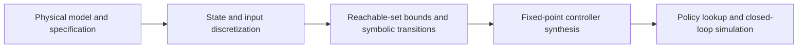

# AUTOMATA

Symbolic controller synthesis for robot navigation and building temperature control, implemented in C++20 for the Computation Theory course.

The project connects continuous physical models with finite-state automata. It builds symbolic abstractions, computes control policies with fixed-point algorithms, and simulates the resulting closed-loop systems under bounded disturbances.

## Contents

- [Overview](#overview)
- [Features](#features)
- [Synthesis pipeline](#synthesis-pipeline)
- [Build and run](#build-and-run)
- [Repository structure](#repository-structure)
- [Validation and current status](#validation-and-current-status)
- [Team](#team)
- [References](#references)

## Overview

The repository contains two independently buildable applications.

| Application | Control objective | Approach |
| --- | --- | --- |
| [Robot navigation](robot_navigation/README.md) | Visit either waypoint R1 or R2, then reach R3 while avoiding R4 and visiting only one waypoint before completion. | A unicycle model, interval reachability, a five-state mission automaton, and backward reachability on the product state space. |
| [Building temperature control](building_temperature_control/README.md) | Keep the temperatures of rooms connected in a ring within a prescribed comfort interval. | Local symbolic abstractions, safety fixed points, and assume-guarantee contracts for the coupled rooms. |

The robot application follows the numerical example in *Approches symboliques pour le contrôle des systèmes non linéaires*. The building application explores compositional control for a coupled thermal network. [Paper by Antoine Girard, Pierre-Jean Meyer and Adnane Saoud](https://doi.org/10.51257/a-v1-s7467)

## Features

### Robot navigation

- **Interactive arena** with draggable and resizable regions, robot position and heading controls, and trajectory visualization.
- **Symbolic abstraction** over a 100 × 100 × 30 spatial grid with 15 discrete control inputs in the graphical application.
- **Mission tracking** with a deterministic finite automaton that records the waypoint already visited.
- **Backward reachability** over 1.5 million combinations of spatial cells and automaton states, with optional OpenMP parallelism.
- **Simulation controls** for step-by-step and continuous execution, bounded disturbances, and bundles of perturbed trajectories.
- **Controller persistence** through binary policy tables.
- **Console prototype** and tests for the model, abstraction, automaton, synthesis, and simulation.

### Building temperature control

- **Coupled thermal dynamics** with heat exchange between neighboring rooms and the exterior.
- **Local safety controllers** obtained by iteratively computing controlled invariant sets.
- **Assume-guarantee composition** using bounds on neighboring room temperatures.
- **OpenMP benchmarks** for synthesizing room controllers across different network sizes.
- **A 24-hour, 16-room simulation** with changing outdoor temperature and CSV output.
- **Course competition benchmarks** and a comparison of local versus global state-space sizes.

## Synthesis pipeline



1. **Model the system.** Define the state, control inputs, disturbances, and desired behavior.
2. **Construct the abstraction.** Partition the state space and compute possible successors for each cell and input.
3. **Synthesize the policy.** Keep commands whose possible outcomes meet the safety or reachability conditions. The robot also tracks progress through its mission automaton.
4. **Apply the controller.** Quantize the measured state, select a command from the policy, and simulate the physical dynamics.

## Build and run

### Prerequisites

- A C++20 compiler, such as GCC 13 or Visual Studio 2022 with the C++ desktop tools.
- CMake 3.20 or later.
- Git, used by CMake to download the robot GUI dependencies on first configuration.
- OpenGL support for the robot application. Linux builds also require the development libraries for the selected GLFW window system.
- OpenMP support for the building application. The robot can also use OpenMP when available.

CMake downloads GLFW 3.4 and Dear ImGui 1.91.5 for the robot interface. These dependencies are configured for the whole robot project, including its console and test targets.

### Clone

```sh
git clone https://github.com/Achraf-Tata/AUTOMATA.git
cd AUTOMATA
```

Run the following commands from the repository root. The examples use Debug builds so the assertion-based tests remain active.

### Robot

```sh
cmake -S robot_navigation -B build/robot -DCMAKE_BUILD_TYPE=Debug
cmake --build build/robot --config Debug --parallel 4
```

On Windows with Visual Studio, launch the GUI and tests with PowerShell.

```powershell
.\build\robot\Debug\prototype_gui.exe
.\build\robot\Debug\test_prototype.exe
```

With Ninja or Unix Makefiles, executables are placed directly in `build/robot`. On Linux, run

```sh
./build/robot/prototype_gui
./build/robot/test_prototype
```

For a Windows Ninja build, use `build\robot\prototype_gui.exe` and `build\robot\test_prototype.exe`.

In the GUI, configure the starting pose and regions, select **Run solver**, then start the simulation. Recompute the controller after editing the arena. [Robot model, controls and implementation notes](robot_navigation/README.md)

### Building

```sh
cmake -S building_temperature_control -B build/building -DCMAKE_BUILD_TYPE=Debug
cmake --build build/building --config Debug --parallel 4
```

On Windows with Visual Studio, run

```powershell
.\build\building\Debug\test_building.exe
.\build\building\Debug\circular_building.exe
```

With Ninja or Unix Makefiles, executables are placed directly in `build/building`. On Linux, run

```sh
./build/building/test_building
./build/building/circular_building
```

For a Windows Ninja build, use the same executable names with the `.exe` extension directly under `build\building`.

The building application prints its benchmarks and writes `circular_building_24h.csv` in the current working directory. [Thermal model and benchmark details](building_temperature_control/README.md)

## Repository structure

```text
AUTOMATA/
├── robot_navigation/
│   ├── include/         Model, grid, automaton, solver and GUI interfaces
│   ├── src/             Synthesis, simulation and application entry points
│   ├── tests/           Robot verification suite
│   ├── CMakeLists.txt
│   └── README.md
├── building_temperature_control/
│   ├── include/         Thermal network and local contract interfaces
│   ├── src/             Contract synthesis, benchmarks and simulation
│   ├── tests/           Thermal network verification suite
│   ├── CMakeLists.txt
│   └── README.md
└── README.md
```

## Validation and current status

The current test suites cover interval calculations, grid indexing, automaton transitions, safety invariance, robot controller synthesis and serialization, disturbed robot trajectories, and coupled room simulations. The robot suite includes a full-resolution synthesis and a 50-run trajectory bundle. The building suite includes an eight-room simulation over 2,000 sampling steps.

The implementation is an academic prototype with the following items still under review.

- The robot console prototype uses different speed samples and a coarser default grid than the GUI. Its default start currently reports an uncontrollable state.
- Robot region labeling uses cell centers. Region edits that cross cell boundaries need further validation of the abstraction.
- Robot simulations currently clamp positions at the workspace boundary. Boundary handling needs to be aligned with the mathematical model.
- Saved robot controllers need configuration matching, and background synthesis needs synchronized access to shared application state.

## Team

- [Zakarya AZE-DINE](https://github.com/zakaryaazedine)
- [Achraf TATA](https://github.com/Achraf-Tata)
- [El Mehdi REGAGUI](https://github.com/Merega1)
- [Adam YASSINE](https://github.com/deejavuuu)
- [Mohamed BOUKHAM](https://github.com/mohammedboukhammail-png)

## References

- Antoine Girard, Pierre-Jean Meyer and Adnane Saoud. *Approches symboliques pour le contrôle des systèmes non linéaires*. Techniques de l’Ingénieur, 2024. [DOI](https://doi.org/10.51257/a-v1-s7467)
- [GLFW](https://www.glfw.org/) and [Dear ImGui](https://github.com/ocornut/imgui) provide the robot interface libraries.
